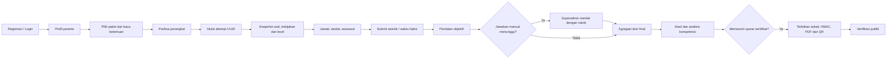
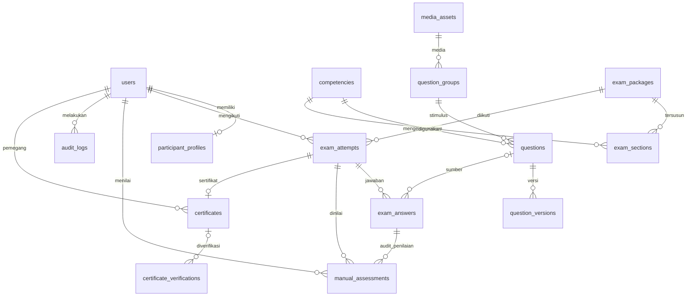
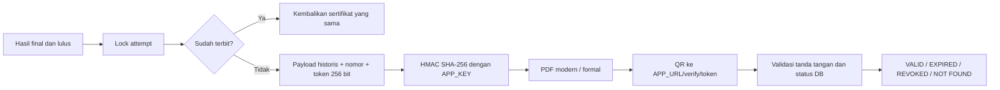

# Arsitektur INBAF

Tiga jenis tes independen (`practice`, `placement`, `certification`) memakai bank soal terpusat dengan izin dan kerahasiaan. [Diagram dan mekanisme lengkap](test-types.md) menjelaskan konfigurasi, snapshot, riwayat, dan sertifikat khusus sertifikasi. Diagram tersedia pula di `/architecture`.

INBAF menggunakan Laravel 13, PHP 8.3+, basis data relasional, Vue 3 dan Tailwind. Aplikasi web dan REST JSON menggunakan origin yang sama. Autentikasi menggunakan sesi Laravel; permintaan yang mengubah data dilindungi CSRF. Hanya terdapat dua role: `superadmin` dan `participant`.

## Alur pengguna

## Tanggung jawab komponen

| Komponen | Tanggung jawab |
| --- | --- |
| Controller autentikasi | Registrasi, sesi, profil, pembatasan login |
| Middleware `superadmin` | Otorisasi administrasi dan pemeriksaan akun aktif |
| `AttemptService` | Jadwal, batas kesempatan, snapshot, jendela sesi, penyimpanan jawaban dan submit |
| `ScoringService` | Penilaian objektif dan manual, agregasi bobot, klasifikasi level |
| `CertificateService` | Penerbitan idempoten dan validasi tanda tangan HMAC |
| `CertificateController` | PDF, verifikasi publik, pencabutan dengan audit |
| Scheduler | Menyelesaikan attempt kedaluwarsa tanpa bergantung pada tab browser |
| Private storage | Stimulus dan jawaban multimedia dengan akses terotorisasi |
| Vue SPA | Dashboard, builder, pengalaman ujian, grafik dan verifikasi |

## ERD inti

Definisi jawaban, opsi, metadata, aturan, rubrik dan hasil disimpan sebagai JSON tervalidasi pada agregat yang relevan. Nama tabel pada spesifikasi awal disederhanakan agar tidak menduplikasi sumber data. `exam_sections.question_ids` menyimpan pemilihan soal; `exam_attempts.snapshot` menyimpan salinan historis lengkap.

Tabel `proficiency_levels`, `question_types` dan `system_settings` menyimpan definisi dinamis. Foreign key, unique index pada jawaban `(exam_attempt_id, question_key)` serta unique `certificates.exam_attempt_id`, nomor dan token melindungi konsistensi.

## Matriks hak akses

| Operasi | Publik | Peserta | Superadmin |
| --- | --- | --- | --- |
| Landing, login, registrasi, verifikasi token | Ya | Ya | Ya |
| Paket tersedia | Ya / sesuai endpoint | Ya | Ya |
| Profil | Tidak | Milik sendiri | Milik sendiri / manajemen peserta |
| Attempt dan jawaban | Tidak | Milik sendiri | Sesuai administrasi hasil |
| Hasil dan PDF | Tidak | Milik sendiri | Seluruh hasil |
| Bank soal, kompetensi, paket, setting | Tidak | Tidak | Ya |
| Penilaian manual dan pencabutan | Tidak | Tidak | Ya, dengan audit |
| Media stimulus | Tidak | Jika terkait attempt yang boleh diakses | Ya |
| Rekaman jawaban | Tidak | Milik sendiri | Untuk evaluasi |

Otorisasi dilakukan pada server. Menyembunyikan tombol pada Vue tidak dianggap sebagai kontrol akses.

## Invarian ujian

1. Mulai attempt mengunci baris pengguna sebelum mengecek kesempatan. Permintaan mulai berulang mengembalikan attempt aktif yang sama.
2. Snapshot menyimpan soal, kunci, bobot, stimulus, jadwal sesi, nama paket, nama peserta, rentang level dan kebijakan sertifikat. Penyuntingan bank soal atau pengaturan sesudah mulai tidak mengubah penilaian historis.
3. Respons ujian hanya memuat atribut aman. Kunci dan pembahasan baru tersedia setelah hasil final jika kebijakan snapshot mengizinkan; soal rahasia dan snapshot lengkap tetap terlindungi.
4. Setiap autosave mengunci attempt dan memeriksa pemilik, status, waktu server serta jendela sesi. Kunci soal asing ditolak.
5. Submit mengunci attempt. Permintaan ulang mengembalikan hasil yang sudah ada. Browser bukan sumber kebenaran untuk waktu tersisa.
6. Jawaban esai atau speaking yang telah dikirim menahan finalisasi sampai dinilai. Jawaban kosong mendapat nol. Skor final dan sertifikat ditunda selama komponen manual menunggu.

## Batas waktu per soal

`questions.duration_seconds` bersifat nullable dan disalin ke snapshot. Klien mengaktifkan soal dengan `POST /api/attempts/{attempt}/questions/{key}/activate` ketika peserta memasuki soal. Baris attempt dikunci, lalu aktivasi pertama menyimpan `exam_answers.question_started_at` dan `question_expires_at`. Deadline adalah minimum dari waktu aktivasi + durasi snapshot, deadline attempt, dan deadline sesi jika sesi dikunci. Mengunjungi kembali soal tidak mengubah kedua waktu tersebut. Durasi null tidak menambahkan batas per soal; batas sesi/attempt tetap berlaku.

Endpoint mengembalikan `answer`, `question_started_at`, `question_expires_at` dan `server_time`; GET attempt juga memuat timestamp pada setiap jawaban. Save pertama mengaktifkan clock secara atomik jika belum diaktifkan oleh klien. Setiap save dan upload rekaman memeriksa deadline server. Respons 422 untuk soal kedaluwarsa memuat `code: question_expired`, `expired_question_key` serta deadline; jawaban terakhir yang tersimpan tetap dinilai dan soal lain tetap dapat dikerjakan. Ini bukan auto-submit seluruh ujian.

Save dari sesi yang sudah tutup mengembalikan 422 `section_closed`, key soal, `answer` terakhir dan waktu server. Klien dapat menghentikan retry untuk edit tersebut lalu melanjutkan antrean jawaban sesi aktif. `section_not_started` menandai sesi mendatang dan bersifat retryable saat waktunya sudah dibuka.

Clock mengukur durasi sejak aktivasi yang dicatat server. Browser tetap dapat menampilkan stimulus yang sebelumnya diterima; batas ini bukan bukti waktu pertama manusia membaca soal. Jaringan terputus atau keluar tab tidak menjeda clock, dan jawaban offline yang baru sampai setelah deadline ditolak. Waktu persiapan, merekam dan upload speaking perlu dimasukkan dalam anggaran durasi soal.

## Model skor

Skor objektif berupa pecahan 0..1. Pilihan tunggal dan benar/salah dibandingkan dengan kunci; jawaban teks dinormalisasi spasi dan huruf; multiple response mendukung tepat seluruh set atau kredit parsial dengan penalti opsi salah. Matching, dropdown, fill blank dan ordering mendukung kesesuaian posisi/pasangan dan kredit parsial bila diaktifkan.

`skor_sesi = 100 × jumlah(fraksi_soal × bobot_soal) / jumlah(bobot_soal)`

`skor_total = jumlah(skor_sesi × bobot_sesi) / jumlah(bobot_sesi)`

Nilai manual 0..100 dikonversi menjadi fraksi sebelum agregasi. Level dan ambang kelulusan menggunakan skor ternormalisasi 0..100 dari snapshot. Pengaturan `score_scale` mengubah skala tampilan final; misalnya hasil normalisasi 80 dengan skala 120 menjadi 96/120. Maksimum skala juga disimpan pada snapshot dan sertifikat. Rubrik manual dan ambang level tetap menggunakan 0..100.

Pemetaan A1..C2 adalah klasifikasi internal. Validasi empiris dan pengakuan eksternal diperlukan sebelum menyatakan kesetaraan resmi dengan CEFR, TOEFL atau UKBI.

## Integritas sertifikat

Payload mengikat identitas pemegang, attempt, nomor, token, hasil, tanggal, lembaga dan template. Nama profil atau paket yang kemudian berubah tidak mengubah sertifikat. HMAC didapat dari representasi JSON dengan urutan key deterministik, lalu dibandingkan menggunakan `hash_equals`. Pencabutan mengubah status dan mencatat alasan dalam audit; alasan dan email tidak tampil di verifikasi publik. Kedaluwarsa dihitung dari tanggal yang ditandatangani.

Ukuran kertas A4/Letter, orientasi portrait/landscape, path logo/background/signature dan hash SHA-256 gambar juga terikat dalam payload. Hanya gambar raster PNG/JPEG/WebP lokal yang lolos pemeriksaan byte dan batas ukuran yang dipakai. PDF menolak asset terikat yang berubah atau hilang; pulihkan file asli dari backup. Background dirender cover dengan opacity 8% agar teks tetap terbaca. Layout menyesuaikan orientasi, sementara pengaturan elemen bebas melalui editor drag belum tersedia.

HMAC ini melindungi catatan sertifikat dan bukan tanda tangan elektronik tersertifikasi pada berkas PDF. Melindungi `APP_KEY`, basis data dan backup tetap diperlukan. Rotasi `APP_KEY` tanpa strategi migrasi tanda tangan membuat sertifikat lama gagal verifikasi.

## Batas keamanan browser

Pindah tab, keluar fullscreen dan kejadian sesi adalah sinyal untuk audit. Browser biasa tidak dapat menjamin pencegahan screenshot, perangkat kedua atau kecurangan. Pembatasan replay audio pada antarmuka juga bukan DRM; pengguna yang dapat mendengarkan media dapat merekamnya. Untuk kebutuhan pengawasan formal, tentukan prosedur identifikasi, akomodasi aksesibilitas dan pengawasan institusi di luar aplikasi.
