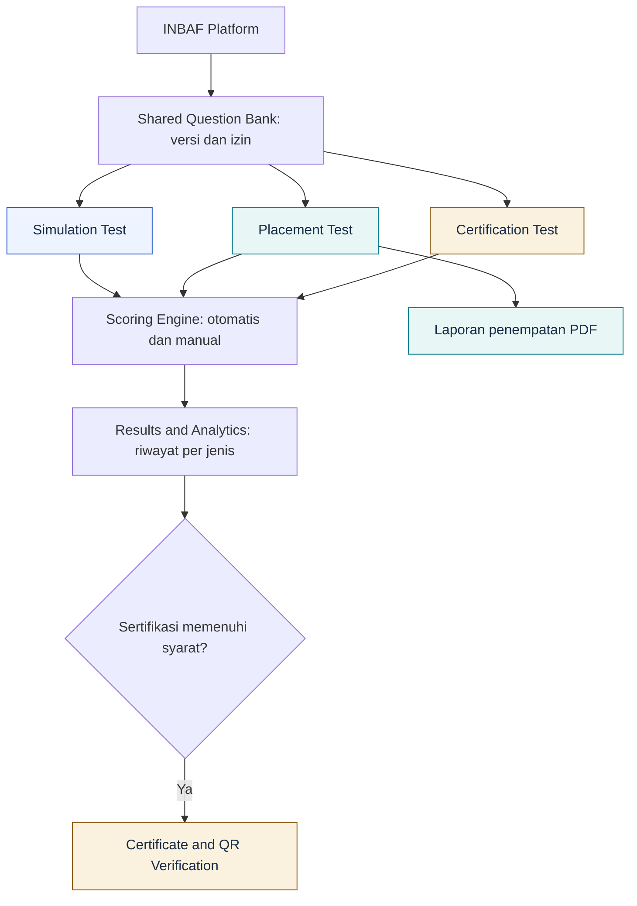
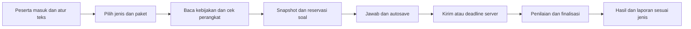
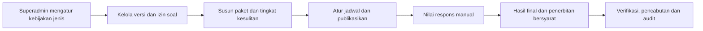

# Jenis tes, bank soal, dan aksesibilitas

Tiga jenis tes dikelola melalui **Settings → Test types** pada tabel `test_types`. Paket memilih satu jenis dan dapat memiliki override; nilai kosong mewarisi kebijakan jenis tes. Perubahan hanya berlaku untuk sesi baru.

| Jenis | Tujuan dan hasil | Sertifikat |
| --- | --- | --- |
| `practice` | Latihan, timer opsional, analisis kompetensi dan pembahasan sesuai izin | Tidak |
| `placement` | Level awal A1–C2 internal, rekomendasi dan laporan PDF | Tidak |
| `certification` | Ujian formal, penilaian otomatis/manual dan finalisasi | Setelah hasil final memenuhi syarat |

Kebijakan mengatur ketersediaan, kesempatan (0 = tidak dibatasi), timer, jendela sesi, pengacakan pilihan, pemantauan keamanan, layar penuh, ambang perpindahan tab, pembahasan, skala skor, metode agregasi, ambang rekomendasi dan level. Paket mengatur jadwal, kode akses, kompetensi, jumlah soal, bobot dan durasi. Jadwal membatasi masuk ke sesi; sesi yang sudah dimulai mengikuti snapshot awalnya.

Metode `weighted_competency` memakai bobot sesi; `weighted_questions` memakai total poin soal; `equal_competency` memberi kontribusi sama untuk setiap kompetensi. Ambang level memakai persentase 0–100, terpisah dari skala skor tampilan. Respons manual menahan skor final dan sertifikat sampai penilaian selesai. Rekomendasi memakai skor kompetensi dan ambang snapshot.

Rata-rata, skor terbaik dan tren bulanan dashboard memakai normalisasi 0–100 agar hasil dengan skala berbeda tetap dapat dibandingkan, termasuk ketika kebijakan skala berubah pada jenis atau paket yang sama. Server memakai `result.normalized_score`; hasil historis tanpa nilai itu dihitung dari `score / result.score_max × 100`, dengan skala 100 bila tidak tercatat. `stats.aggregate_score_max` bernilai 100. Skor masing-masing hasil dan `stats.latest_score` tetap memakai skala snapshot; `stats.latest_score_max` menyatakan skala skor terakhir, sedangkan `stats.score_max` dipertahankan untuk kompatibilitas. Filter jenis, paket, tanggal dan pemilik tetap membatasi data statistik. Saat filter dashboard atau riwayat hasil diganti cepat, respons permintaan lama tidak menggantikan hasil filter terbaru.

## Satu bank soal

`questions.allowed_test_types` mengizinkan satu atau beberapa jenis tes tanpa menggandakan soal. Soal rahasia hanya boleh digunakan untuk sertifikasi. Soal baru dan bank lama tetap khusus sertifikasi sampai diberi izin eksplisit. Hanya materi awal publik bertanda `starter_content` yang dibagikan saat upgrade.

Pemilihan manual dan acak memeriksa status aktif, kompetensi, tingkat kesulitan, izin, kerahasiaan dan batas penggunaan. Pemakaian dicatat saat sesi berhasil dimulai pada `question_usages`, termasuk versi dan waktu. Resume tidak menambah penggunaan. Penguncian baris dan transaksi menjaga batas penggunaan serta membatalkan reservasi jika gagal mulai. Riwayat lama diisi dari snapshot. Duplikasi soal tetap tersedia; penghitung salinan dimulai dari nol.

`question_versions` menyimpan versi editorial. Snapshot sesi menyimpan soal, kunci, opsi, stimulus, bobot, kebijakan dan level. Perubahan bank/paket tidak mengubah hasil lama. Pembahasan hanya dikirim setelah hasil final jika diizinkan snapshot; soal rahasia selalu terlindungi. Template CSV/XLSX baru membawa izin, kerahasiaan, batas penggunaan, durasi soal dan pembahasan; template lama 13 kolom tetap diterima dengan izin khusus sertifikasi sebagai default.

Pembahasan membawa metadata snapshot yang sudah disanitasi untuk menampilkan label pasangan kiri/kanan serta label dan pilihan setiap isian. Antarmuka menampilkan teks jawaban yang terbaca, termasuk urutan dan pilihan ganda, serta tidak menampilkan baris jawaban benar untuk esai, speaking atau soal berpenilaian manual. Metadata internal dan kunci tersembunyi dalam metadata tetap disaring; kunci jawaban pembahasan hanya tersedia melalui kebijakan hasil final yang mengizinkannya.

## Aksesibilitas dan keamanan

**Text size / Ukuran teks** menyediakan Normal, Large dan Extra Large pada header workspace dan ujian. Pilihan disimpan di akun melalui `PUT /api/preferences`, dipulihkan saat login, dan disimpan di browser untuk halaman publik. Navbar publik selalu berada di atas saat scroll dan tidak menampilkan dropdown ukuran teks; preferensi ukuran yang sudah dipilih tetap diterapkan pada halaman publik. Ukuran `rem` berlaku pada menu, formulir, bacaan, soal, jawaban, hasil dan verifikasi. Plus Jakarta Sans dibundel lokal. Halaman ujian menyediakan petunjuk Indonesia/Inggris, navigasi nomor soal, status autosave dan kontrol media sesuai aturan soal.

Pada pemutar audio yang sedang terbuka, pause lalu melanjutkan audio tetap dihitung sebagai satu pemutaran. Pengulangan setelah audio selesai memakai kesempatan berikutnya jika batas pemutaran masih mengizinkan.

Sesi tanpa timer memiliki `expires_at = null`, tidak masuk antrean kedaluwarsa, dan tidak mengaktifkan deadline soal/sesi. Pengubahan ukuran teks tidak mengubah waktu. Pemantauan browser mencatat perpindahan tab/layar penuh dan memberi peringatan menurut ambang snapshot; ini merupakan sinyal audit, bukan bukti pengawasan perangkat atau deteksi kecurangan menyeluruh.

## Diagram

Diagram dengan teks besar juga tersedia di footer workspace melalui **Diagram arsitektur / System map** (`/architecture`).

A1–C2 merupakan klasifikasi internal INBAF. Platform tidak mengklaim pengakuan pemerintah atau kesetaraan TOEFL/UKBI/CEFR. Adaptive testing tetap arah pengembangan; pemilihan saat ini berdasarkan bank dan tingkat kesulitan terkonfigurasi, belum menggunakan model adaptif terkalibrasi.

## Upgrade

Buat backup privat, lalu jalankan `php artisan migrate --force`, `php artisan db:seed --force` dan `npm.cmd run build`. Migrasi menambah struktur dan mempertahankan hasil/sertifikat lama sebagai sertifikasi. Paket sertifikasi lama dengan `policy_overrides = null` mempertahankan batas kesempatan, aturan sesi dan skala skor global lama. Detail paket admin mengembalikan `effective_policy`; editor memakai nilai efektif tersebut untuk menampilkan override lama, termasuk skala skor, secara eksplisit. Menyimpan edit paket lama mempertahankan skala itu; kosongkan override untuk memilih pewarisan kebijakan jenis tes. Seeder mempertahankan akun dan sandi yang sudah ada.
